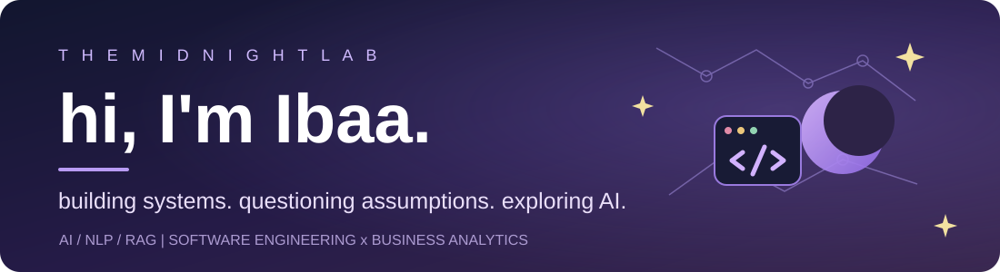

<!-- THE MIDNIGHT LAB | GitHub profile of Ibaa Belhadj -->

  

  <strong>Software Engineering &#215; Business Analytics</strong> 
  AI / NLP / RAG / Applied Research 
  Montr&#233;al, Canada

  <a href="https://www.linkedin.com/in/ibaa-belhadj-6435b6266/">LinkedIn</a>
  &#160; &#183; &#160;
  <a href="https://github.com/L1lith04">GitHub</a>

---

### ✦ 01 / behind the screen

Hi! I'm **Ibaa**, a double-degree student combining **Software Engineering at SMU MedTech** with **Business Analytics at HEC Montr&#233;al**.

I love the part of engineering where an interesting idea becomes something we can **build, test, question, and explain**. My interests sit at the intersection of machine learning, software systems, and practical problem-solving.

What keeps me curious:

- Can an AI system **show the evidence** behind its answer?
- How can we understand **when a model fails**, not just when it succeeds?
- How do we turn research ideas into tools that are actually useful?

*My working motto: build it, question it, improve it.*

 

### ✦ 02 / notes from the lab

| Project | What it explores | Where it's at |
| :--- | :--- | :--- |
| **MedRAG 🧪** | Local LLMs, RAG, medical-document analysis, and grounded follow-up questions | Actively improving; private repository |
| **Emotion in Text 🧠** | BERT-based emotion classification and NLP evaluation | Earlier research internship; no public code yet |
| **Neurons in Python 🌊** | Hodgkin-Huxley model, numerical simulation, and scientific visualization | Existing academic project; documentation planned |
| **Takoyaki ✨** | A full-stack AI-assisted recipe application | Previous project; documentation planned |

> This is a living lab notebook. Some projects are still private or being documented; I'll add public repositories and reproducible results as they're ready.

### ✦ 03 / what I build with

**Languages:** `Python` `JavaScript`  
**AI & ML:** `BERT` `Hugging Face` `LangChain` `Ollama` `ChromaDB` `RAG`  
**Apps & Engineering:** `Streamlit` `Vue.js` `Node.js` `MongoDB` `Git`

### ✦ 04 / outside the terminal

I enjoy turning complex ideas into **clear presentations, useful visualizations, and good conversations**. Through **IEEE EMBS at SMU**, I've also worked on building a student engineering community and bringing people together around interdisciplinary ideas.

### ✦ 05 / currently looking for

**Research-oriented AI/ML internships and software-engineering PFE / capstone collaborations**, especially projects where I can help build and evaluate technically meaningful systems.

If you're working on NLP, reliable AI, healthcare-related software, or applied ML research, I'd love to connect on **[LinkedIn](https://www.linkedin.com/in/ibaa-belhadj-6435b6266/)**.

---

✦ currently building, testing, and learning ✦

