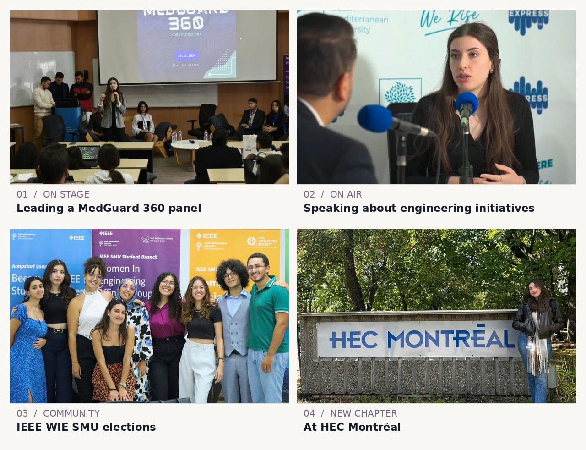

  

  <a href="https://www.linkedin.com/in/ibaa-belhadj-6435b6266/">LinkedIn</a> ·
  <a href="https://github.com/L1lith04">GitHub</a>

---

### ✦ 01 / a little about me

I'm Ibaa, a double-degree student in **Software Engineering at SMU MedTech** and **Business Analytics at HEC Montréal**.

I love the technical side of building things, but I also love **bringing people together around an idea**. Whether I'm experimenting with machine learning, working on a software project, organizing an IEEE initiative, or speaking to an audience, I enjoy turning complex ideas into something people can understand and use.

What keeps me curious is not only *whether a system works*, but also **why it works, where it fails, and what it could do better**.

### ✦ 02 / things I've built & explored

| Project | What I worked on | Status |
| :--- | :--- | :--- |
| **MedRAG · Medical AI assistant** | Local medical-document analysis with LLMs, Ollama, LangChain, ChromaDB, and Streamlit. Currently improving document-grounded Q&A and evidence traceability. | 🛠️ In development · private repository |
| **Emotion classification** | BERT-based emotion detection, fine-tuning, and NLP evaluation during an AI research internship. | 🔬 Internship project · not publicly released |
| **Hodgkin–Huxley simulation** | Modeling neuron action potentials in Python using numerical methods and scientific visualization. | 📓 Previous project · documentation planned |
| **Takoyaki** | An AI-assisted recipe application with a full-stack web architecture using Vue.js, Node.js, and MongoDB. | 📓 Previous project · documentation planned |

*I prefer to share projects with clear explanations, reproducible examples, and honest limitations. More public repositories are coming as I prepare them.*

### ✦ 03 / beyond the code

A big part of my engineering journey has been about **people, leadership, and communication**.

I helped establish the **IEEE EMBS student chapter at SMU**, contributed to **IEEE WIE SMU**, led a panel at **MedGuard 360**, presented engineering initiatives, and had the opportunity to discuss our work on the radio. Moving to Montréal to continue my studies at HEC has been another meaningful chapter.

  

### ✦ 04 / my toolkit

**Programming & applications:** Python · JavaScript · Vue.js · Node.js · MongoDB · Streamlit

**Machine learning & NLP:** BERT · Hugging Face · LangChain · RAG · Ollama · ChromaDB

**Beyond the stack:** Research-minded problem solving · Technical presentations · Community building · Teamwork

### ✦ 05 / what I'm looking for

I'm interested in **research-oriented AI/ML internships and software engineering PFE/capstone opportunities**, particularly work involving NLP, reliable AI, evaluation, and healthcare-related software.

I want to contribute to technically meaningful projects, learn from researchers and engineers, and keep improving the way I build and communicate ideas.

**Have an interesting project or research question?** [Let's connect on LinkedIn ↗](https://www.linkedin.com/in/ibaa-belhadj-6435b6266/)

---

*Building thoughtfully. Asking better questions. Bringing ideas to life. ✦*
