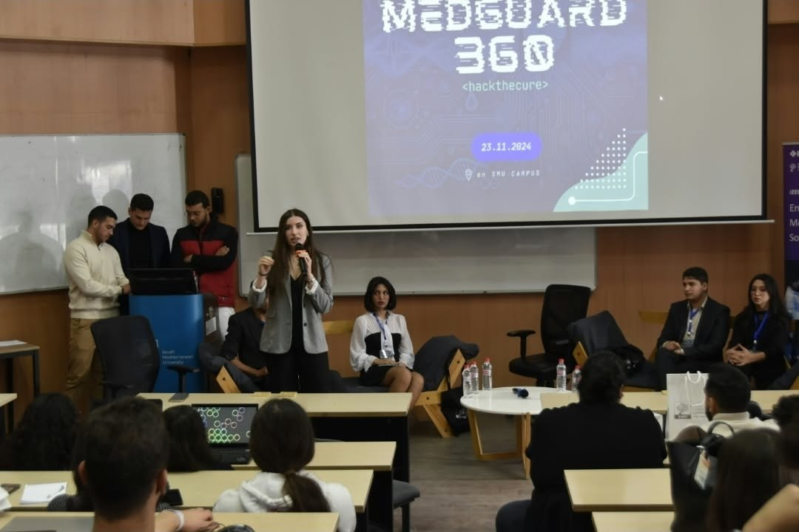
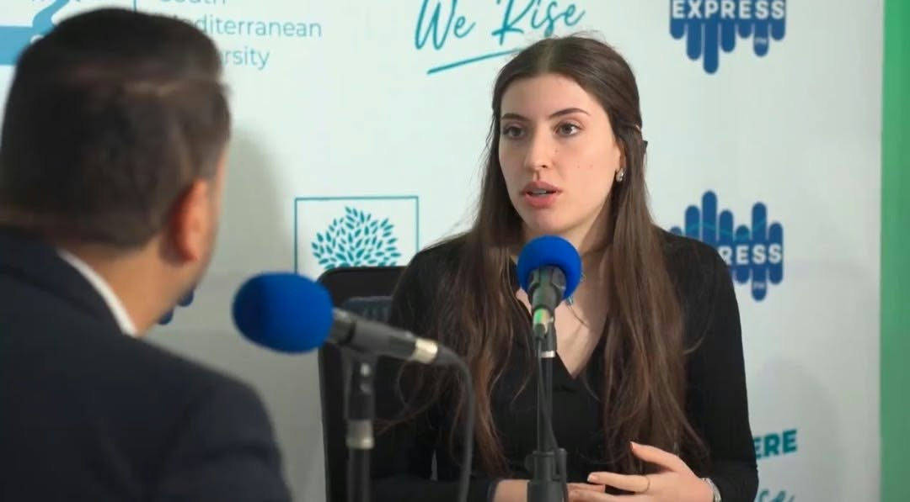
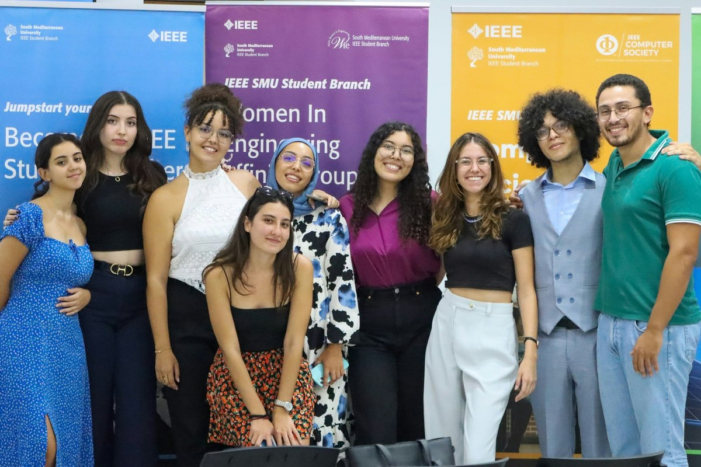
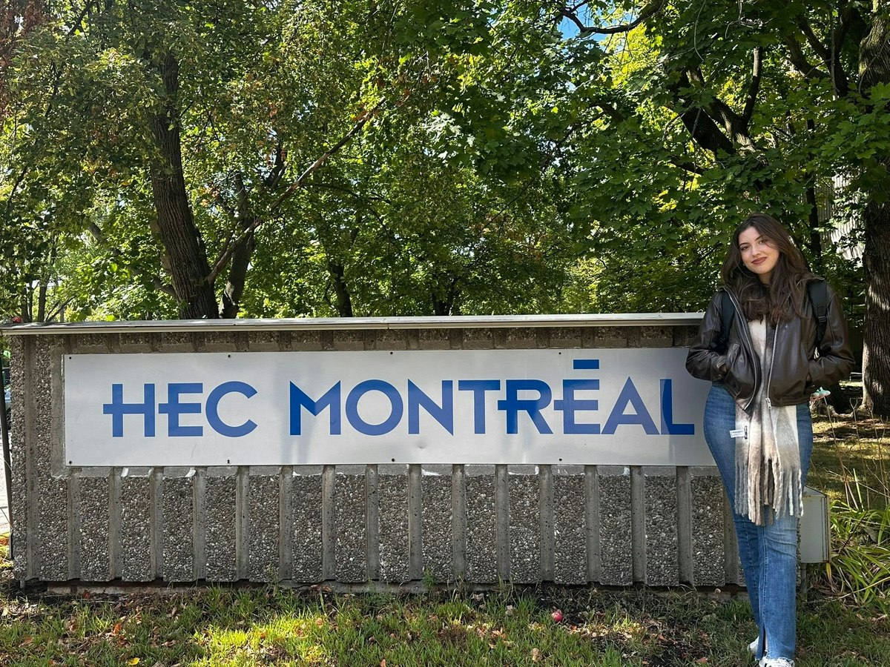

# hi, I'm Ibaa 👋

### Somewhere between engineering, strategy & storytelling.

**Software Engineering @ SMU MedTech** · **Business Analytics @ HEC Montréal**  
📍 Montréal, Canada

[LinkedIn](https://www.linkedin.com/in/ibaa-belhadj-6435b6266/) · [GitHub](https://github.com/L1lith04)

---

### ✦ 01 / a little about me

I like building things, but I also love **bringing people together around an idea**.

I'm pursuing a double degree in software engineering and business analytics. My interests sit at the intersection of **AI, technical problem-solving, strategy, and communication**. One day I'm working through a machine-learning experiment; another, I'm presenting a plan, organizing an engineering initiative, or talking about technology on the radio.

I care about making technology **useful, understandable, and worth trusting**, not just getting a demo to run.

### ✦ 02 / what I'm building & exploring

| Project or experience | What I worked on | Where it stands |
| --- | --- | --- |
| **MedRAG** | Local medical-document assistant using LLMs, LangChain, ChromaDB, Ollama, and Streamlit; improving document-grounded questions and sources | 🛠️ In development · private repository |
| **Emotion classification & NLP evaluation** | BERT-based emotion classification and evaluation during an AI research internship | 🔬 Past internship work; not published here |
| **Hodgkin–Huxley neuron simulation** | Python simulation of neuron action potentials, numerical methods, and visualization | 📓 Previous project; documentation planned |
| **Takoyaki** | Full-stack, AI-assisted recipe application built with Vue, Node.js, and MongoDB | 📓 Previous project; documentation planned |

*I'm preparing public code and reproducible demonstrations as projects are ready. A private repository is not the same as a published portfolio project.*

### ✦ 03 / beyond the IDE

Some of my favorite engineering moments have happened **in front of a room, around an organizing table, or behind a microphone**.

I helped found and lead **IEEE EMBS at SMU**, worked with the **IEEE WIE SMU** student community, presented initiatives, and led discussions about technology and healthcare innovation. Those experiences shaped how I work with people as much as how I work with code.

<table>
  <tr>
    <td width="50%" valign="top">
      
       <b>On stage</b> · Leading a MedGuard 360 panel discussion
    </td>
    <td width="50%" valign="top">
      
       <b>On air</b> · Talking about our engineering initiatives
    </td>
  </tr>
  <tr>
    <td width="50%" valign="top">
      
       <b>With a team</b> · IEEE WIE SMU elections
    </td>
    <td width="50%" valign="top">
      
       <b>A new chapter</b> · Studying at HEC Montréal
    </td>
  </tr>
</table>

### ✦ 04 / my toolkit

**Programming & apps:** Python · JavaScript · Vue.js · Node.js · MongoDB · Streamlit  
**AI & NLP:** BERT · Hugging Face · LangChain · RAG · Ollama · ChromaDB  
**Also important to me:** technical writing · presentations · research questions · teamwork

### ✦ 05 / what's next?

I'm looking for a **technically meaningful AI/ML research internship or software engineering PFE/capstone collaboration**—especially opportunities involving NLP, reliable AI systems, evaluation, or healthcare-related software.

I want to contribute to serious technical work while continuing to grow as an engineer.

**Have an interesting research question or project?** [Let's connect on LinkedIn ↗](https://www.linkedin.com/in/ibaa-belhadj-6435b6266/)

---

Build thoughtfully. Communicate clearly. Keep learning. ✦

